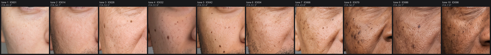
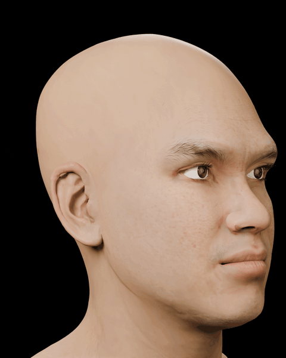
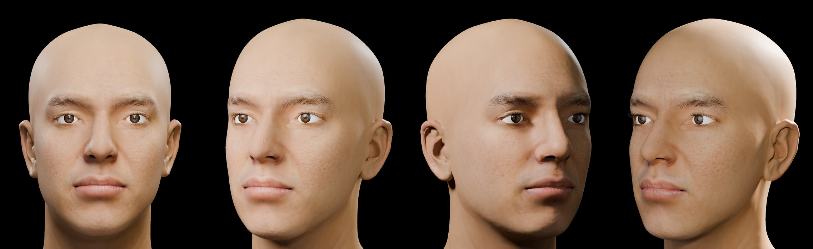
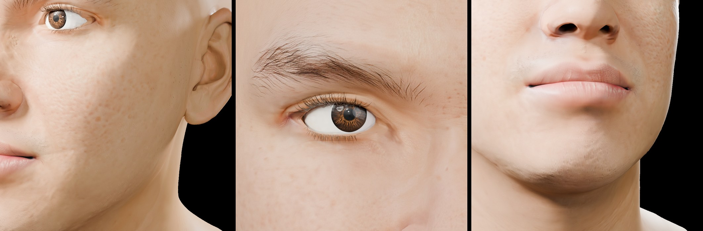
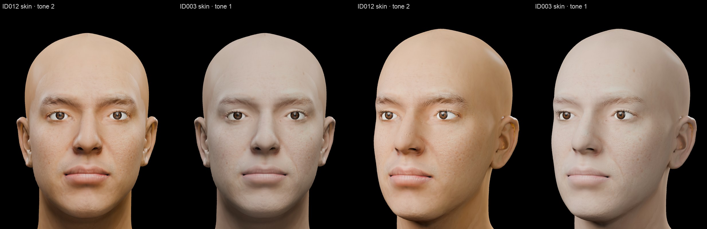

# Synthetic Portraits 100

One hundred AI-generated studio portraits of people who do not exist, one for each combination of **10 prompted
skin tones × 5 age bins × 2 gender presentations**, with skin tone measured from every image. The design balances
skin appearance rather than race: the same number of portraits for every prompted tone. The measurements then
check whether the generator actually delivered the tones it was asked for: at the ends of the scale it did, but
the middle tones came out almost the same.

**[Browse the gallery](https://0vvi.github.io/synthetic-portraits-100/)** (filter by tone, age and gender) ·
[What the measurements show](#what-the-measurements-show) · [3D case study](#3d-case-study-one-identity-so-far) ·
[Reproduce](#reproduce)


*All 100, one row per prompted Monk Skin Tone (1 = lightest, 10 = deepest); along a row, the five age bins
from 18–29 to 75+, a woman and a man in each.*

## Highlights

- **A balanced design, delivered exactly:** 10 per tone, 20 per age bin, 50 women and 50 men.
- **Skin tone measured, not assumed:** face detection, two landmark-placed cheek patches, CIELAB colour and the
  Individual Typology Angle (ITA) for every image.
- **A clear finding:** prompting tones 2–6 barely changes the measured skin tone, and the set skews light even
  though every prompted tone has the same count.
- **Reproducible and traceable:** the design sheet and all 100 prompts regenerate exactly from one seed, and every
  original image has a recorded sha256.

## What the measurements show


| Prompted tone | 1 | 2 | 3 | 4 | 5 | 6 | 7 | 8 | 9 | 10 |
|---|---|---|---|---|---|---|---|---|---|---|
| median ITA (°) | 65.5 | 55.4 | 53.3 | 51.5 | 52.0 | 51.4 | 44.4 | 36.6 | 25.4 | 5.0 |

- The measured cheek ITA falls with the prompted tone overall, but **tones 2–6 overlap almost completely**:
  naming a middle tone in the prompt barely moves the measured cheek ITA. From tone 7 to 10 the medians fall
  steadily, with wide overlap between neighbours.
- Measured, the set skews light: 26 very light, 45 light, 10 intermediate, 13 tan, 5 brown, 1 dark. Equal
  counts per prompted tone do not give equal coverage of measured tone.
- For a v1, describing the tone (lightness, undertone) instead of naming it is the obvious next experiment.



*Unretouched skin at the original resolution (320 px crops of 1792 × 2400 images): for each prompted tone,
the portrait whose measured ITA is closest to that tone's median.*

## What is in it

| Path | Contents |
|---|---|
| `images/thumbs/ID001.jpg` … `ID100.jpg` | the portraits at 600 × 800 (the originals are 1792 × 2400 JPEG) |
| `labels/identities_v0.csv` | the design sheet: prompted tone, age, gender presentation and prompt descriptors |
| `labels/measurements_v1.csv` | per image: face box, cheek ITA, the two cheeks' ITA difference, L\*, b\*, Del Bino class, sharpness, duplicate hash |
| `labels/provenance.json` | per image: the generator's file name, sha256 and size |
| `prompts/` | the prompt template and the 100 prompts exactly as sent |
| `code/` | design sheet, prompts, harvest, measurement, figures and gallery data |
| `index.html` | the browsable gallery, served at the link above |
| `docs/3d/` | renders of the 3D skin material (ID012; ID003 on the same head for comparison) |

## How it was made

1. **Design sheet** (`code/make_manifest.py`, seed 20260918). Ten Monk Skin Tone bins × five adult age bins
   (18–29, 30–44, 45–59, 60–74, 75+) × two gender presentations, one identity per cell. Each row also gets
   a region-of-ancestry descriptor, a hair style, optional facial hair and, for 30 rows, a pigment feature
   (moles, freckles, solar lentigines, post-inflammatory marks, mild melasma). The region lists of
   neighbouring tones overlap, which reduces but does not remove the link between region and tone. The
   descriptors steer the prompt; they are not labels. After the first five portraits, "shaved head" was
   dropped from women's rows (v0.1, 14 rows); the repository copy of the script applies that rule, so it
   reproduces the sheet that was used.
2. **One prompt per row** (`code/build_prompts.py`, `prompts/PROMPT_TEMPLATE.md`): a front-facing,
   evenly lit, unretouched head-and-shoulders portrait on mid-grey, forehead and ears visible, no glasses,
   jewellery or make-up. The generator takes no seed; the `seed` column is the row's own.
3. **Generation:** Gemini web app, Images mode (Nano Banana 2), aspect 3:4, full-size download
   (1792 × 2400), 18–20 Sep 2026. Each download was copied once with its sha256 (`code/harvest.py`) and
   never edited. Two portraits were regenerated (ID001, first made at the wrong aspect ratio; ID092, too
   close to ID082) and one prompt was re-sent after a lost render (ID058).
4. **Measurement** (`code/measure.py`): YuNet face detection at 640 px width (one face in every image),
   two landmark-placed cheek patches, the median CIELAB colour of each, ITA = atan((L\* − 50) / b\*) in
   degrees for each cheek, averaged over the two; the Del Bino class follows from ITA. Near-duplicates are
   screened with a 64-bit DCT hash of the face: four pairs fall under the threshold, and all four were
   checked by eye and are different people.

Counts came out exactly as designed: 10 per tone, 20 per age bin, 50 women and 50 men.

## 3D case study: one identity so far







*ID012 ("a 27-year-old East Asian man, shaved head") as an 8K UV skin texture on a 3D head, rendered in
Blender Cycles with random-walk subsurface scattering: front, three-quarter, Rembrandt and backlit light;
cheek, eye and lip close-ups.*



*The same head shape and light with two identities' skin materials: ID012 (prompted tone 2) and ID003
(prompted tone 1, "a 38-year-old East Asian woman"). Only the skin textures differ.*

The texture comes from the identity text, not from the portrait: an image model recolours a template skin
texture toward the description, and automatic gates check every result at 2048, 4096 and 8192 (layout,
openings, lips, nose, baked shading, fine detail). A private head pipeline then adds displacement, eyes,
lashes, brows and shading. The head shape is a generic FLAME 2023 Open head, not a fit to the portrait, so the
render is the identity's skin, not a 3D likeness of the photograph.

**Status:** 31 of the 100 identities have a texture that passes every gate. Only ID012 has been rendered so far,
with ID003's texture on the same head for comparison; the other identities are not rendered yet. The texture
and head pipeline is not part of this repository.

## Limits

- One identity per cell: good for coverage, too small for per-cell statistics.
- ITA comes from studio-lit JPEGs, not a colour-calibrated capture. On 29 portraits the two cheeks differ by
  more than 20° (side light, stubble or shadow); the `ita_lr_diff` column flags them.
- The people are synthetic, but a generated face can resemble a real person by chance.
- Estimated age and gender are not measured yet.
- Adults only (18+).
- The 3D renders cover one identity so far.

## Reproduce

Run from the repository root (Python 3, `numpy`, `opencv-python` 5.0, `Pillow`, `matplotlib`):

```
python3 code/make_manifest.py                                  # labels/design_v0.csv from seed 20260918
python3 code/build_prompts.py labels/identities_v0.csv --all > prompts/prompts_identities_v0.txt
python3 code/measure.py identities                             # labels/measurements_v1.csv from portraits/identities/
python3 code/make_sheets.py portraits/identities               # images/thumbs/ and docs/contact_sheet.jpg
python3 code/skin_strip.py portraits/identities                # docs/skin_detail.jpg
python3 code/plot_ita.py portraits/identities                  # docs/ita_by_tone.png
python3 code/make_gallery_data.py                              # labels/gallery.json for index.html
python3 code/make_social_card.py                               # docs/social_card.jpg, the gallery's link preview
```

`make_manifest.py` writes the unmeasured design sheet; its design columns match `labels/identities_v0.csv`
row for row, and `build_prompts.py` reproduces the 100 prompts byte for byte (both checked 5 Nov 2026).
Re-running `measure.py` on the originals reproduces `labels/measurements_v1.csv` (checked 4 Nov 2026). The
full-size images (287 MB) are not in this repository; put them in `portraits/identities/`.

## Terms and use

The portraits were made with Google Gemini. Google states that it does not claim ownership of generated
content. Its terms also list "using AI-generated content from our services to develop machine learning
models or related AI technology" as abuse, so this set is published for viewing and evaluation, not as
training data. See Google's [Terms of Service](https://policies.google.com/terms) and
[Generative AI Prohibited Use Policy](https://policies.google.com/terms/generative-ai/use-policy).
Google says Gemini images carry an invisible SynthID watermark; the originals are byte-identical to the
downloads.

## Who wrote what

Design, prompts, generation runs and measurement: Claude Code sessions directed by Ao Zuo, 18–20 Sep 2026.
This repository, the measurement fix and the public write-up: the same way, 4–5 Nov 2026.

## Licence

- Code (`code/`, `index.html`): MIT, see `LICENSE`.
- Images, labels and prompts: [CC BY-NC 4.0](https://creativecommons.org/licenses/by-nc/4.0/), see
  `LICENSE-DATA`. Credit: "Synthetic Portraits 100, Ao Zuo, 2026".
- `code/face_detection_yunet_2023mar.onnx` is from [opencv_zoo](https://github.com/opencv/opencv_zoo),
  MIT licence, copyright (c) 2020 Shiqi Yu (`code/YUNET_LICENSE`).
