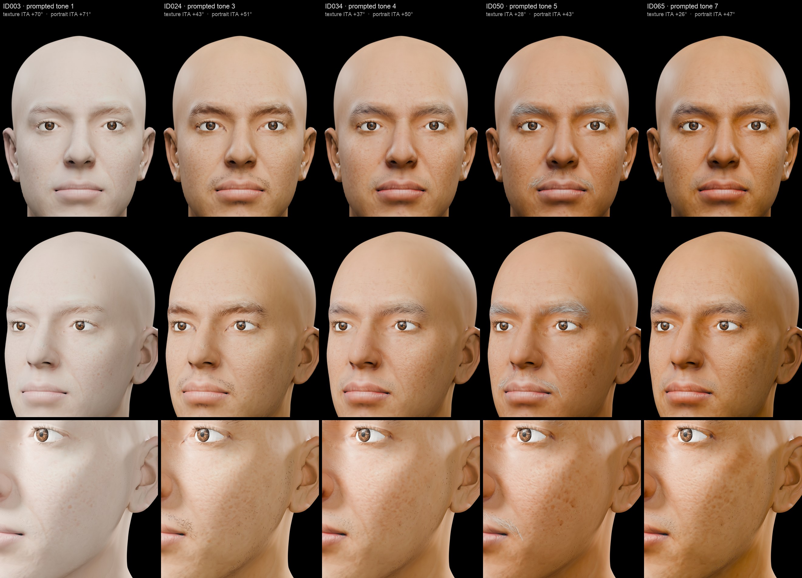
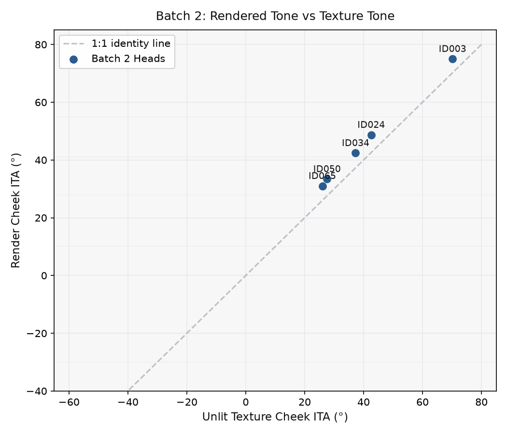

# 3D skin materials, batch 2: five more skins on the ladder

The first tone ladder (`docs/3d/`) has skins at prompted tones 1, 2, 6, 7, 8, 8 and 9, so it jumps from tone 2
to tone 6. Batch 2 renders five more gated skin textures the same way, adding tones 3, 4 and 5 plus a
second tone-1 and tone-7 skin. Nothing in `docs/3d/` outside this folder was changed.

*Five identities' skin on one head, lightest to deepest texture cheek ITA: ID003, ID024, ID034, ID050, ID065.
Rows: front (H01), three-quarter (H03), cheek close-up (C01).*

## How they were made

These are ladder heads, like the seven in the first ladder. The head shape, eyes, brow shape, lights and
per-shot exposure are the hero's (ID012e). Only the identity's skin maps change: colour, subdermal colour,
scattering weight and specular, plus the ear's colour tile matched to each skin. Each head has the same seven
shots as the hero: four lighting setups (H01–H04) and three close-ups (C01 cheek, C02 eye, C03 lips). The
renders are Blender Cycles at 128 samples, 1200×1500 (heads) and 1024×1024 (close-ups); see `renders.csv`.

| Head | Prompted tone | Description (from `labels/identities_v0.csv`) | Portrait ITA | Texture ITA | Render ITA |
|:---:|:---:|:---|:---:|:---:|:---:|
| ID003 | 1 | woman, 38, East Asian, "very light, pale skin" | +70.7° | +70.2° | +75.0° |
| ID024 | 3 | man, 31, Southern European, "light skin with warm undertone" | +50.6° | +42.6° | +48.7° |
| ID034 | 4 | man, 34, mixed heritage, "light-medium skin" | +50.1° | +37.3° | +42.4° |
| ID050 | 5 | man, 84, Southeast Asian, "medium skin" | +42.8° | +27.6° | +33.4° |
| ID065 | 7 | woman, 57, South Asian, "tan-brown skin" | +47.0° | +26.0° | +31.0° |

Per head: [ID003](ID003_renders.jpg) · [close-ups](ID003_closeups.jpg) —
[ID024](ID024_renders.jpg) · [close-ups](ID024_closeups.jpg) —
[ID034](ID034_renders.jpg) · [close-ups](ID034_closeups.jpg) —
[ID050](ID050_renders.jpg) · [close-ups](ID050_closeups.jpg) —
[ID065](ID065_renders.jpg) · [close-ups](ID065_closeups.jpg)

## Tone

The front renders are measured like the portraits (YuNet at 640 px, two cheek patches;
`render_vs_texture_ita.csv`). They keep the textures' order and read +4.8° to +6.1° lighter than their textures,
in line with the four lightest skins of the first ladder (+5° to +8°).

## Limits

- One generic FLAME head for every skin: a render shows the identity's skin, not a 3D likeness of the portrait.
  On this head the two women (ID003, ID065) read masculine.
- The portrait and the texture disagree a lot for ID034, ID050 and ID065 (13–21° of ITA): the texture comes from
  the text description, not from the portrait.
- Some stubble comes with the shared template skin: it shows faintly on ID065, whose description has no facial hair.
