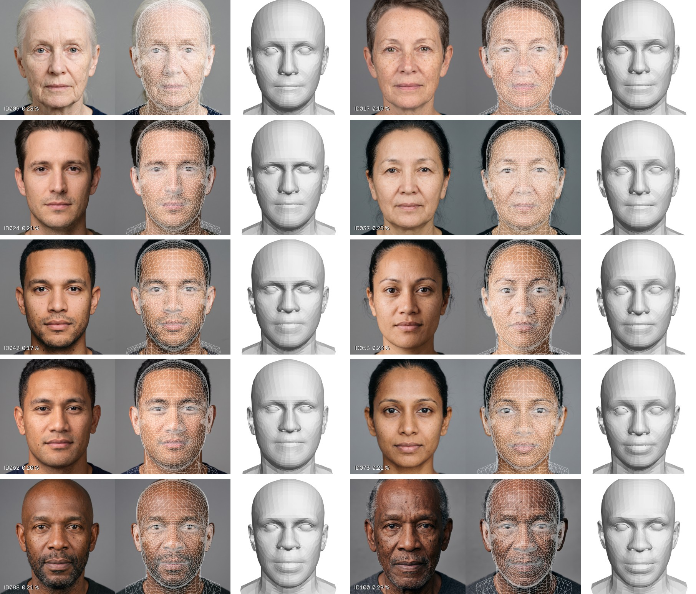
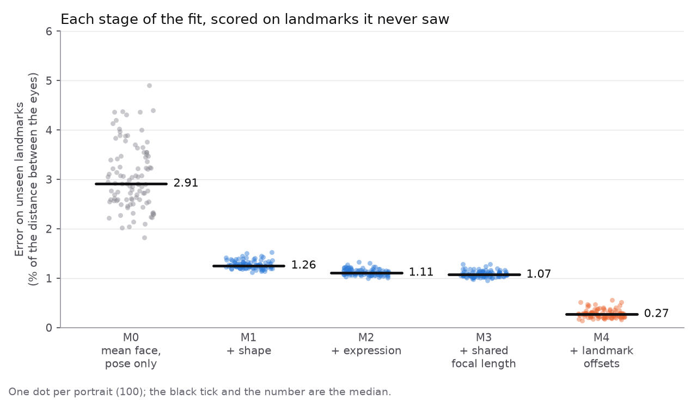
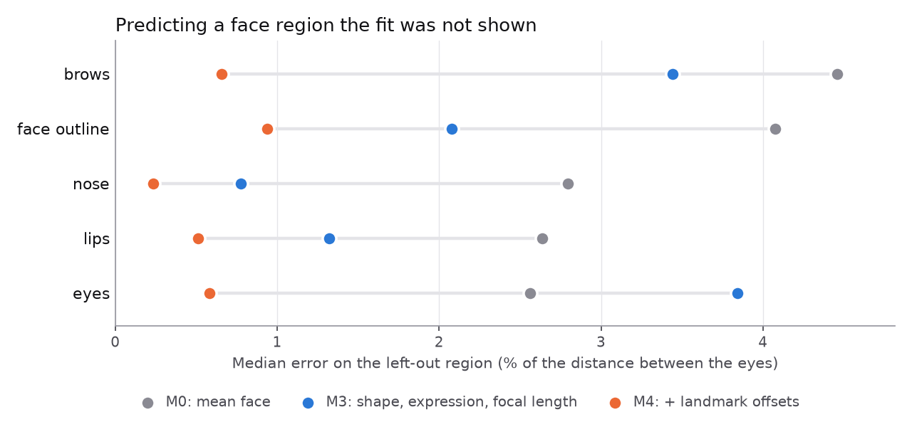
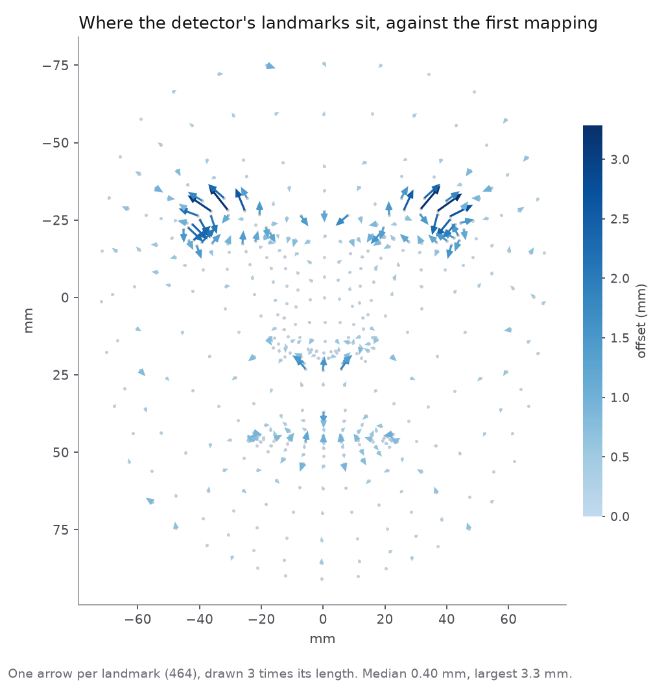
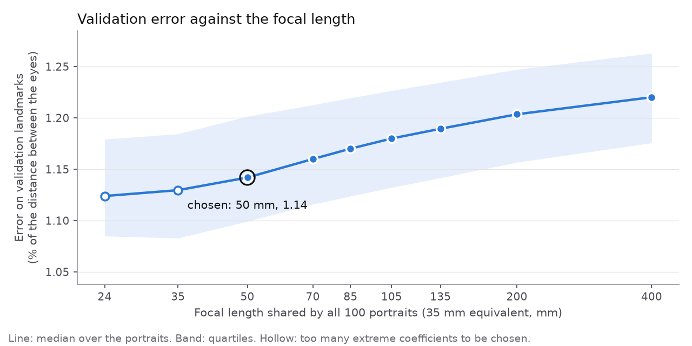

# Head-shape fit

A 3D head model is fitted to each of the 100 portraits, and every stage of the fit is scored on landmarks it
never saw. The solver exists twice, in numpy and in C++17, written to one contract and compared with each other.



*Ten portraits, one per prompted tone (for each tone, the portrait whose fit error is the median of its tone).
Left: the portrait. Middle: the fitted head drawn over it. Right: the fitted head alone, seen by the fitted camera.
The number is the fit's landmark error in percent of the distance between the eyes.*

The 3D renders elsewhere in this repository use these fitted shapes (shape only, neutral expression): each
rendered skin sits on its own identity's fitted head.

## In short

- **What is fitted.** [FLAME 2023 Open](https://flame.is.tue.mpg.de) (a statistical 3D head model: a mean head
  plus shape and expression directions learned from scans) and one camera pose per portrait, to the 468 face
  landmarks that [MediaPipe Face Landmarker](https://ai.google.dev/edge/mediapipe/solutions/vision/face_landmarker)
  finds in the image.
- **How it is scored.** The landmarks are split once: 60 % are fitted, 20 % choose the settings, and 20 % are
  kept for the final score: a portrait's test landmarks never enter its own fit or the choice of a setting
  (stage M4 adds one qualification, [below](#the-landmark-offsets-m4)). Error is the distance between a
  predicted and an observed landmark, in percent of the distance between the eyes (a median of 384 px on these
  1792 × 2400 images).
- **Result.** On unseen landmarks the mean head with its best pose misses by 2.91 % (about 11 px). The full fit
  misses by 0.27 % (about 1 px), and is better than the mean head on all 100 portraits.
- **A finding on the way.** Fitting shape alone left a floor of about 1.1 %. The remaining error was almost the
  same on every portrait: the detector's landmarks do not sit exactly where the first landmark-to-head mapping
  put them, by up to 3.3 mm around the eyes. Offsets learned on half of the portraits remove it on the other half.
- **What it does not show.** There is no ground-truth 3D shape for these faces. The fit is a landmark-constrained
  estimate from one frontal still, so depth is weakly determined (see [Limits](#limits)).

## The stages

Each stage adds one thing, so each number says what that thing bought.



| Stage | What it adds | Chosen setting | Error on test landmarks, median (quartiles) | Largest shape coefficient, median | Portraits with a coefficient beyond 3 |
|---|---|---|---|---|---|
| M0 | mean face, camera pose only | 85 mm | 2.91 (2.58 to 3.47) | 0.00 | 0 % |
| M1 | + shape | 85 mm; 200 shape, prior 1.5 | 1.26 (1.23 to 1.32) | 1.88 | 3 % |
| M2 | + expression | 85 mm; 200 shape, prior 1; 50 expression, prior 1 | 1.11 (1.08 to 1.16) | 2.19 | 2 % |
| M3 | + one focal length for all portraits | 50 mm; 200 shape, prior 1; 50 expression, prior 1 | 1.07 (1.04 to 1.13) | 2.16 | 5 % |
| M4 | + landmark offsets learned from other portraits | 50 mm; 200 shape, prior 0.5; 50 expression, prior 0.75 | 0.27 (0.22 to 0.31) | 1.73 | 4 % |
| control | mean face with the M4 offsets | 50 mm | 2.55 (2.22 to 3.07) | 0.00 | 0 % |

Errors are in percent of the distance between the eyes, over 93 test landmarks per portrait. Coefficients are in
standard deviations of the head model. Focal lengths are 35 mm equivalents. A prior is the weight that pulls a
coefficient towards zero, in percent of the eye distance per unit of coefficient.

How the settings were chosen:

- For every stage a ladder of settings was tried (18 for M1, 324 each for M2 and M4, 9 focal lengths for M3)
  and the one with the lowest median error on the validation landmarks was kept.
- A setting could only be kept if it left the faces plausible: at most 5 % of the portraits with a coefficient
  beyond 3 standard deviations. Without this rule the choice drifts to ever weaker priors and faces with
  coefficients of 4 to 7, because validation landmarks sit between fitted ones and reward any extra freedom.
- The test landmarks were read once, after every choice was made.

## A harder test: a whole region left out

Unseen landmarks that sit between fitted ones are easy. So each face region in turn is left out of the fit
completely, and the error is measured on that region.



| Region left out | Landmarks | M0 | M1 | M2 | M3 | control | M4 |
|---|---|---|---|---|---|---|---|
| face outline | 36 | 4.07 | 2.27 | 2.26 | 2.08 | 3.97 | 0.94 |
| lips | 36 | 2.64 | 1.59 | 1.35 | 1.32 | 2.73 | 0.51 |
| nose | 24 | 2.80 | 0.92 | 0.78 | 0.77 | 2.38 | 0.24 |
| eyes | 32 | 2.56 | 3.20 | 3.90 | 3.84 | 1.79 | 0.58 |
| brows | 20 | 4.46 | 1.70 | 3.35 | 3.44 | 4.46 | 0.66 |

Median error on the left-out region, in percent of the distance between the eyes. In M4 the left-out region
takes no part in the portrait's own fit, but its landmarks still carry the offsets learned from the other half
of the portraits: the test asks whether a region can be predicted from the rest of the face plus what the
detector does on other faces.

Up to M3 the fit had a real weakness: with the eyes left out it predicted them **worse** than the mean face did
(3.84 against 2.56), and adding expression made the brows worse (1.70 to 3.35). That is what led to M4.

## The landmark offsets (M4)

The first mapping from MediaPipe's landmarks to the FLAME surface was built from geometry alone
(`embedding/build_embedding.py`: FLAME is fitted to MediaPipe's canonical face mesh, and each landmark is
projected onto the fitted surface). On real images the detector places some landmarks elsewhere, most of all
around the eyes (the eye contours and the upper eyelids).



- The offsets are one small shift per landmark, along the face plane (a frontal still says nothing about a
  landmark's depth). Median 0.40 mm, 95th percentile 1.68 mm, largest 3.28 mm (on an upper eyelid); the eye-contour landmarks'
  median is 1.37 mm.
- They are learned from other portraits. The 100 portraits are split into two halves; each half is fitted with
  offsets learned only from the other half. Every M4 number above is measured that way.
- What that holds out, and what it does not. Learning the offsets uses every landmark of the other half's
  portraits, the test landmarks among them. So M4's score is held out across portraits: a portrait's own test
  landmarks take no part in its fit or in the offsets applied to it, but the offset of each test landmark was
  learned on that same landmark in other portraits. Stages M0 to M3 never use the test landmarks at all.
- The two halves give the same offsets: correlation 0.999, a mean difference of 0.035 mm against a mean size of
  0.574 mm. So the offsets describe the detector and the head model, not particular faces.
- The offsets alone do little: the mean face with offsets (the control row) still misses by 2.55 %. The gain
  comes from the shape fit once the systematic part is out of its way.
- One thing the offsets cannot separate: a mapping error from an average difference between these generated
  faces and FLAME's mean face. Both are absorbed.

## The focal length (M3)



| Focal length (mm) | Validation error, median (quartiles) | Eligible |
|---|---|---|
| 24 | 1.12 (1.08 to 1.18) | no |
| 35 | 1.13 (1.08 to 1.18) | no |
| 50 | 1.14 (1.10 to 1.20) | yes (chosen) |
| 70 | 1.16 (1.12 to 1.21) | yes |
| 85 | 1.17 (1.12 to 1.22) | yes |
| 105 | 1.18 (1.13 to 1.23) | yes |
| 135 | 1.19 (1.14 to 1.23) | yes |
| 200 | 1.20 (1.16 to 1.25) | yes |
| 400 | 1.22 (1.18 to 1.26) | yes |

The landmarks say little about the focal length. Over a sixteen-fold range the validation error moves by 0.10.
It falls slowly towards shorter lenses, but below 50 mm more than 5 % of the faces need extreme coefficients, so
50 mm is the shortest setting that keeps the faces plausible, not a sharp optimum. It puts the camera about
0.57 m from the face. Read it as "a normal lens fits no worse than a long one", not as a measurement of the
generator's virtual camera.

## Two solvers, one contract

[`SPEC.md`](SPEC.md) fixes the maths before any code: the camera model, the residuals, the hand-derived
Jacobian (the matrix of derivatives of every residual with respect to every unknown), the Levenberg-Marquardt
loop (a standard solver for least-squares problems), the interfaces and the tests. Two implementations follow it:

- `solver_ref.py`: numpy, written for clarity.
- [`fitcore/`](fitcore/): C++17 with Eigen, a Python module through pybind11, and a batch call that fits many
  portraits on several threads.

On the 100 real problems (464 landmarks and 250 coefficients each) the two give the same fits: every fit ends
with the same status after the same number of steps, the largest difference in any coefficient is 5.2e-14, and
the costs agree to 1.2e-14 (relative). These last digits move a little from run to run, because numpy's matrix
library is multi-threaded.

| Solver | One fit, median | 100 fits, one after another | 100 fits, one batch on all cores |
|---|---|---|---|
| numpy reference (Accelerate BLAS) | 21.6 ms | 2.29 s | |
| C++ core, Eigen only | 24.5 ms | 2.67 s | 0.74 s |
| C++ core, Eigen over a BLAS library (`-DFITCORE_BLAS=ON`) | 7.0 ms | 0.75 s | 0.49 s |

Measured on an Apple M5 (4 performance and 6 efficiency cores). Read the table with care. Almost all of a fit's
time is one matrix product per step, and numpy already hands that product to Apple's Accelerate library, so the
reference is not slow. The first build of the C++ core was slower than numpy here; forming only half of the
symmetric product and a faster factorization brought it level. With plain Eigen the core gains only by fitting
many portraits at once (0.74 s against 2.29 s for the 100). Built over the same library it is three times faster
on a single fit. The whole evaluation, 141,600 fits, takes under five minutes with the C++ core.

The tests need neither FLAME nor the portraits: known-answer problems for the rotation formula, the Jacobian
against finite differences, recovery of known parameters, the prior, zero-weight landmarks and a pose-only fit,
in C++ and in Python, plus the two implementations against each other. They run on every push
(`.github/workflows/fitcore.yml`).

## Reproduce

Without FLAME (the tests and the charts):

```
pip install -r fit/requirements.txt
cmake -S fit/fitcore -B build/fitcore -DCMAKE_BUILD_TYPE=Release -DFITCORE_PYTHON=ON \
      -Dpybind11_DIR=$(python -m pybind11 --cmakedir)
cmake --build build/fitcore -j && ctest --test-dir build/fitcore --output-on-failure
python -m pytest fit/tests -q                     # numpy tests, and C++ against numpy
python fit/figures.py                             # the three charts, from fit/results/*.csv
python fit/report.py                              # the tables on this page, from fit/results/*.json
```

The fit itself needs the FLAME 2023 Open model, which is not redistributed here. Download `flame2023_Open.pkl`
and `FLAME_masks.pkl` from the [FLAME site](https://flame.is.tue.mpg.de), then:

```
python fit/flame_io.py --pkl flame2023_Open.pkl --masks FLAME_masks.pkl    # fit/assets/ (ignored by git)
python fit/embedding/build_embedding.py           # the landmark-to-FLAME mapping
python fit/run_fit.py                             # all stages; about 5 minutes with the C++ solver
python fit/run_fit.py --solver ref --quick --out /tmp/quick                # numpy only, coarse settings, 2 minutes
python fit/compare_solvers.py                     # C++ against numpy on the 100 real problems
FITCORE_BUILD_DIR=build/fitcore-blas python fit/compare_solvers.py --label blas   # the same for a -DFITCORE_BLAS=ON build
python fit/figures.py                             # also the overlay and the offsets picture
```

`fit/landmarks.py` and `fit/regions.py` re-create the landmark files from the full-size portraits and the
MediaPipe model (Apache-2.0, downloaded separately); their outputs are already in `fit/results/`.

## Files

| Path | What it is |
|---|---|
| `SPEC.md` | the contract: maths, interfaces, tests, evaluation protocol, dated corrections |
| `solver_ref.py`, `fitcore/` | the numpy reference and the C++ core |
| `tests/` | numpy tests and the C++-against-numpy tests |
| `embedding/` | the landmark-to-FLAME mapping (triangle and weights per landmark) and the script that builds it |
| `landmarks.py`, `regions.py`, `flame_io.py`, `problem.py` | data preparation and shared pieces |
| `run_fit.py`, `compare_solvers.py`, `figures.py`, `report.py` | the stages and evaluation, the solver comparison, the figures, the tables |
| `results/landmarks_mp478.npz`, `results/regions_mp468.json` | the detected landmarks of the 100 portraits, and the landmark ids of each face region |
| `results/selection.csv` | every setting tried, with its validation error and whether it was eligible |
| `results/stages.csv`, `results/region_test.csv`, `results/focal_sweep.csv` | per-portrait errors behind the tables |
| `results/landmark_offsets.npz`, `results/fits_final.npz` | the M4 offsets, and the fitted pose and coefficients of every portrait |
| `results/summary.json`, `results/solver_agreement.json`, `results/solver_agreement_blas.json` | the numbers quoted on this page |

## Limits

- **No ground truth.** Nothing here measures how close a fitted head is to a real 3D face: the people do not
  exist, and no scan does. The scores say how well the model explains landmarks, including ones it did not see.
- **The landmarks come from a detector with its own idea of a face.** MediaPipe regresses a full mesh, so its
  landmarks are smoother and more regular than hand-marked ones. A low error means FLAME can reproduce
  MediaPipe's mesh, which is necessary for a good shape and not sufficient.
- **One frontal still.** Depth is weakly determined: the focal length barely matters to the error, and the
  offsets have no depth component.
- **The offsets fit this detector, this head model and these portraits** (frontal, studio framing, one image
  generator). They were checked across halves of this set, not on other images.
- **Not fitted:** jaw rotation, the face silhouette, the iris size as a distance cue. Four of the 468 landmarks
  (two pairs at the mouth corners) are left out because the mapping put the upper lip's point below the lower's.
- **Plausibility is a rule, not a guarantee:** in the final fits 4 % of the portraits still have a coefficient
  beyond 3 standard deviations (the largest is 3.99).

## Credits and licences

- FLAME 2023 Open head model (Li et al., Max Planck Institute for Intelligent Systems),
  [CC BY 4.0](https://creativecommons.org/licenses/by/4.0/). The model files are not in this repository; the
  mapping, the offsets and the fitted coefficients are.
- MediaPipe Face Landmarker and its canonical face mesh (`embedding/third_party/`), Google, Apache-2.0.
- [Eigen](https://eigen.tuxfamily.org) (MPL-2.0) and [pybind11](https://github.com/pybind/pybind11) (BSD-3-Clause)
  are build dependencies, not copied here.
- Written with Claude Code sessions, 11–12 Nov 2026. The C++ core and the numpy
  reference were written separately from `SPEC.md` and then compared. A second model recomputed the tables on
  this page from the per-portrait files in `results/`; the evaluation code and this text have not had an
  independent review yet.
